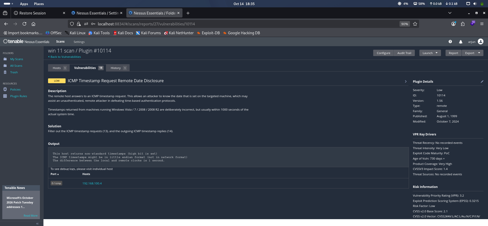
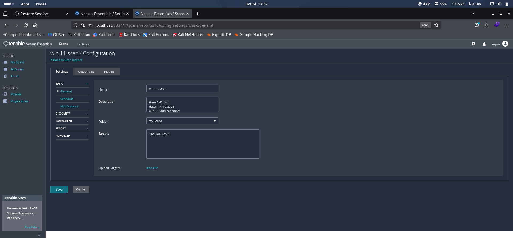
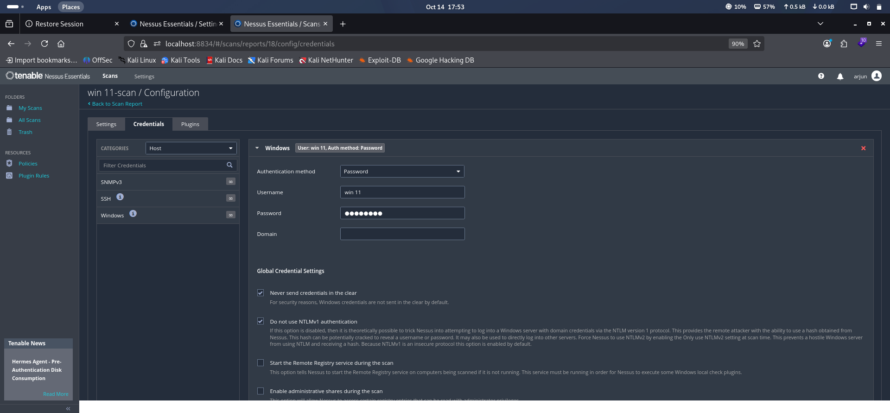
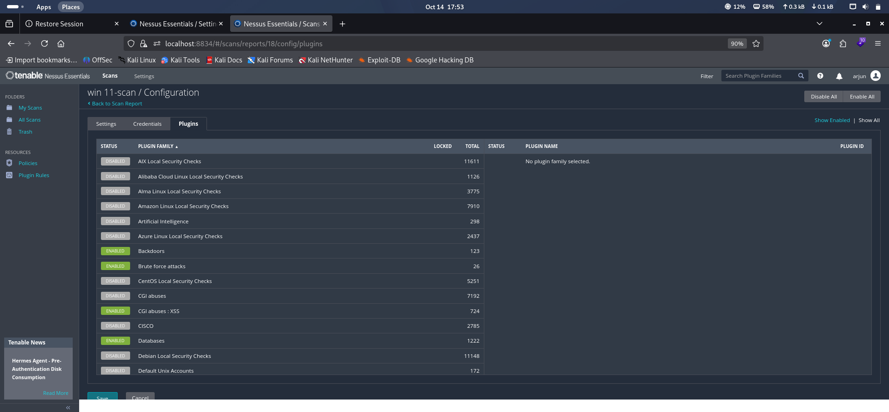
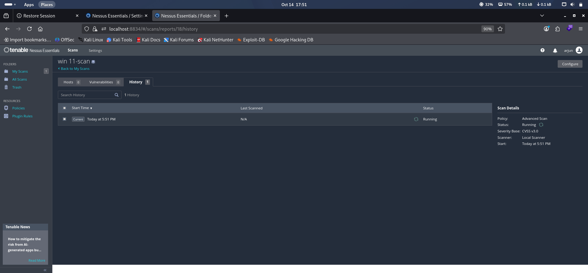
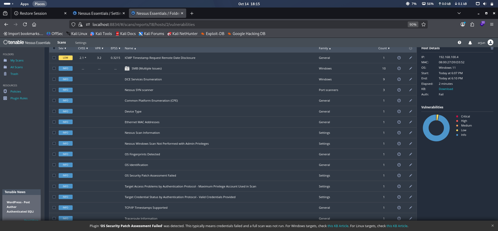
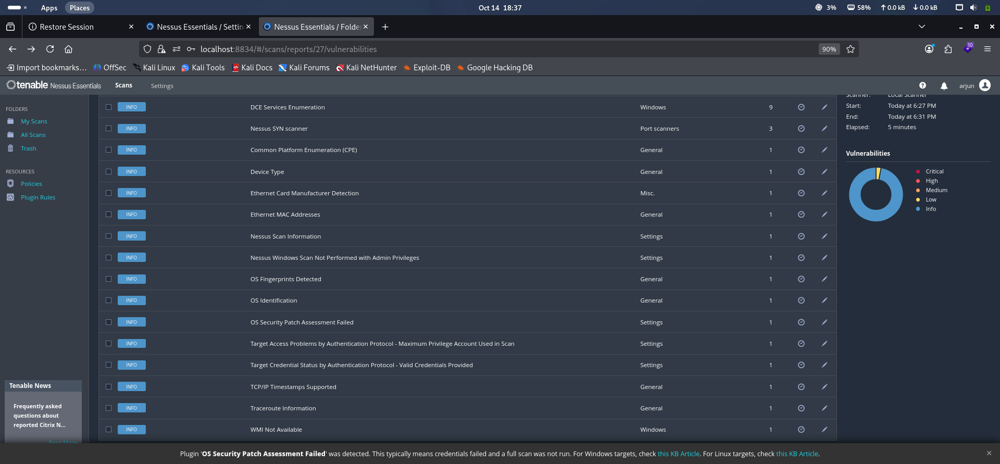
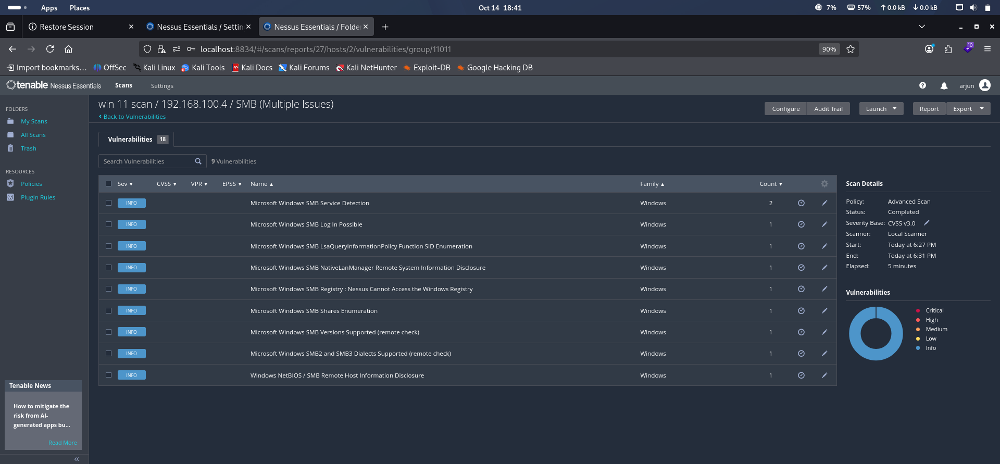

# Nessus Vulnerability Assessment – Windows 11

## Project Overview

A vulnerability assessment lab using Tenable Nessus Essentials to scan a Windows 11 virtual machine, analyze security findings, identify exposed services, and document remediation recommendations.

The assessment was performed in an isolated VirtualBox lab environment using Kali Linux as the Nessus scanner and Windows 11 as the target.

## Lab Environment

- **Scanner:** Tenable Nessus Essentials 10.12.3
- **Scanner OS:** Kali Linux
- **Target OS:** Windows 11
- **Target IP:** `192.168.100.4`
- **Scanner IP:** `192.168.100.5`
- **Scan Policy:** Advanced Scan
- **Virtualization:** Oracle VirtualBox
- **Scan Type:** Normal Scan

## Objectives

- Identify open ports and exposed network services.
- Perform a vulnerability assessment using Nessus.
- Analyze findings according to severity.
- Review SMB service exposure and ICMP timestamp disclosure.
- Understand authentication and permission limitations during vulnerability scanning.
- Document findings and recommended remediation measures.

## Tools Used

- **Tenable Nessus Essentials** – Vulnerability scanning and assessment.
- **Kali Linux** – Scanner operating system.
- **Windows 11** – Target virtual machine.
- **Oracle VirtualBox** – Virtual lab environment.

## Assessment Methodology

1. Configured Kali Linux and Windows 11 virtual machines in the lab network.
2. Configured Nessus Essentials and its vulnerability plugin feed.
3. Created an Advanced Scan targeting the Windows 11 machine.
4. Executed the scan against the authorized lab target.
5. Reviewed detected ports, services, operating system information, and vulnerabilities.
6. Examined the ICMP timestamp finding and SMB-related results.
7. Documented the scan limitations and remediation recommendations.

## Vulnerability Assessment Results

The Nessus scan completed successfully against the Windows 11 target.

| Finding | Severity | Result |
|---|---|---|
| ICMP Timestamp Request Remote Date Disclosure | Low | Detected |
| SMB service and configuration enumeration | Informational | Detected |
| Windows operating system identification | Informational | Detected |
| Open TCP ports 135, 139 and 445 | Informational | Detected |
| WMI availability issue | Informational | Detected |
| OS security patch assessment | Incomplete | Permission limitations |

No Critical, High, or Medium vulnerabilities were confirmed in the supplied scan results.

## Key Finding: ICMP Timestamp Request Remote Date Disclosure

**Severity:** Low  
**Affected Target:** `192.168.100.4`  
**Plugin ID:** `10114`  
**CVSS v2 Base Score:** `2.1`

### Description

The target responded to an ICMP timestamp request. This behavior can disclose information about the target system's clock and may provide an attacker with additional information during reconnaissance.

### Potential Impact

The information disclosed is limited, but it may assist an attacker in gathering information about the target system.

### Recommended Remediation

- Filter unnecessary incoming ICMP timestamp requests (Type 13).
- Filter outgoing ICMP timestamp replies (Type 14).
- Review firewall rules and validate the change with another scan.

### Evidence



## SMB Service Assessment

Nessus identified SMB-related services and configuration information on the Windows 11 target.

Detected TCP ports included:

- **135/tcp** – Microsoft RPC endpoint mapper.
- **139/tcp** – NetBIOS session service.
- **445/tcp** – SMB over TCP.

### Security Recommendations

- Restrict SMB access to trusted systems and networks.
- Disable SMBv1 if it is enabled and not required.
- Review SMB sharing permissions.
- Ensure Windows security updates are installed.
- Apply firewall rules based on the system's actual requirements.

The informational SMB findings do not, by themselves, confirm an exploitable vulnerability.

## Authentication and Scan Limitations

Nessus reported that credentials were accepted for SMB authentication, but some checks could not access resources requiring additional permissions.

The scan reported issues involving:

- Access to the `ADMIN$` share.
- Windows registry access through SMB.
- Windows Management Instrumentation (WMI) availability.
- OS security patch assessment.

These limitations prevented Nessus from completing all local security and patch checks.

### Recommended Improvements

1. Verify that the scan account has the required administrative privileges.
2. Review remote registry and administrative share access.
3. Check Windows firewall rules and remote management configuration.
4. Review the Nessus credential configuration.
5. Repeat the credentialed scan and compare the results.

These settings should be changed only in the authorized lab, without unnecessarily disabling Windows security protections.

## Scan Summary

- **Scan Status:** Completed
- **Target:** Windows 11 virtual machine
- **Scanner:** Nessus Essentials running on Kali Linux
- **Confirmed Low-Severity Finding:** ICMP Timestamp Request Remote Date Disclosure
- **Informational Results:** SMB enumeration, service discovery, and operating system identification
- **Important Limitation:** Incomplete Windows patch assessment due to permission restrictions

The results demonstrate the vulnerability assessment workflow, severity review, evidence collection, and identification of limitations affecting scan coverage.

## Screenshots and Evidence

### 1. Target Setup



### 2. Windows Password Setup



### 3. Nessus Plugin Configuration



### 4. Scan in Progress



### 5. Vulnerability Findings Overview



### 6. Vulnerability Details


### 7. CVE and CVSS Details



### 8. Additional Vulnerability Details



## Project Structure

```text
Nessus Vulnerability Assessment/
├── screenshots/
│   ├── 01-target-setup.png
│   ├── 02-windows-password-setup.png
│   ├── 03-plugin-setup.png
│   ├── 04-scanning-ongoing.png
│   ├── 05-vulnerability-findings.png
│   ├── 06-vulnerability-details.png
│   ├── 07-cve-and-cvss-details.png
│   └── 08-vulnerability-details.png
├── .gitignore
├── findings.md
└── README.md
```

## Skills Demonstrated

- Vulnerability assessment using Nessus Essentials.
- Network service and port identification.
- Vulnerability severity analysis.
- SMB security review.
- Basic risk assessment and remediation planning.
- Credentialed scan troubleshooting.
- Security evidence documentation.

## Disclaimer

This project was performed in an authorized virtual lab for educational and portfolio purposes only. The findings apply to the lab configuration and should not be interpreted as a security assessment of any production system.
